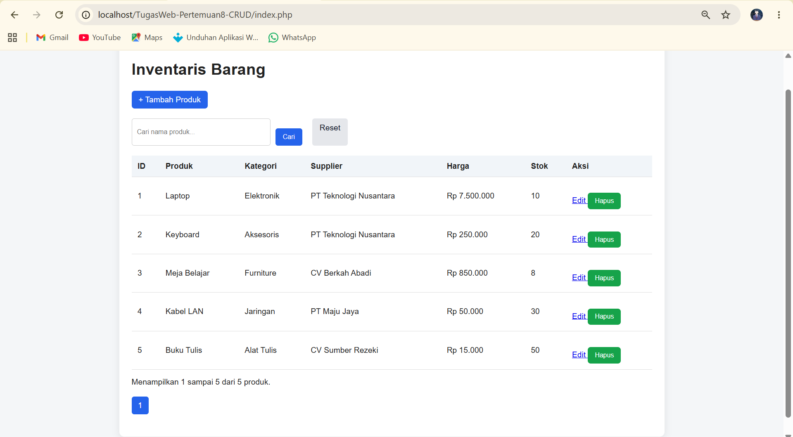

# TugasWeb-Pertemuan8-CRUD

**Tugas Rutin 8 — Pemrograman Web**  
**CRUD Inventaris menggunakan PHP Native, PDO, dan MySQL**

## Identitas

- **Nama:** Muhammad Ariq Lubis
- **Mata Kuliah:** Pemrograman Web
- **Pertemuan:** 8

## Deskripsi

Aplikasi CRUD Inventaris merupakan aplikasi pengelolaan data inventaris menggunakan PHP Native, PDO, dan MySQL. Aplikasi ini dibuat untuk menerapkan database relasional, operasi CRUD, prepared statements, dan keamanan input pengguna.

## Fitur

- Create: menambahkan data produk.
- Read: menampilkan daftar produk dengan JOIN kategori dan supplier.
- Update: mengubah data produk.
- Delete: menghapus data produk dengan konfirmasi.
- Search: mencari produk berdasarkan nama.
- Pagination: membagi daftar produk menjadi beberapa halaman.
- PDO Singleton: menggunakan pola Singleton untuk koneksi database.
- Prepared statements: membantu mencegah SQL Injection.
- Sanitasi output HTML menggunakan `htmlspecialchars()`.

## Teknologi

- PHP Native
- MySQL
- PDO
- HTML dan CSS
- XAMPP
- phpMyAdmin

## Struktur Proyek

```text
TugasWeb-Pertemuan8-CRUD/
├── config/
│   └── database.php
├── screenshots/
│   ├── daftar-produk.png
│   ├── search.png
│   └── pagination.png
├── index.php
├── create.php
├── edit.php
├── delete.php
├── style.css
├── schema.sql
└── README.md
```

## Persyaratan

- XAMPP
- Browser
- Visual Studio Code (opsional, untuk mengedit kode)

## Cara Menjalankan Aplikasi

### 1. Siapkan proyek

Salin atau clone repository ini ke folder `htdocs` XAMPP:

```text
C:\xampp\htdocs\TugasWeb-Pertemuan8-CRUD
```

### 2. Jalankan XAMPP

Buka XAMPP Control Panel, kemudian jalankan Apache dan MySQL.

### 3. Import database

1. Buka `http://localhost/phpmyadmin`.
2. Pilih menu **Import**.
3. Klik **Choose File** dan pilih file `schema.sql` dari folder proyek.
4. Klik **Import** atau **Go** untuk menjalankan file SQL.
5. Pastikan database `inventaris_db` berhasil dibuat beserta tabel dan data awalnya.

File `schema.sql` berisi struktur database, relasi antartabel, dan seed data.

### 4. Periksa konfigurasi database

Buka `config/database.php` dan pastikan konfigurasi koneksi sesuai dengan MySQL lokal. Konfigurasi default XAMPP umumnya menggunakan host `localhost`, pengguna `root`, dan password kosong.

### 5. Buka aplikasi

Akses alamat berikut melalui browser:

```text
http://localhost/TugasWeb-Pertemuan8-CRUD/
```

## Screenshot Aplikasi



## Catatan

Pastikan Apache dan MySQL aktif sebelum menjalankan aplikasi. Database harus diimpor terlebih dahulu agar fitur CRUD, Search, dan Pagination dapat digunakan.

---

**Pemrograman Web — Tugas Rutin 8**  
Universitas Negeri Medan
